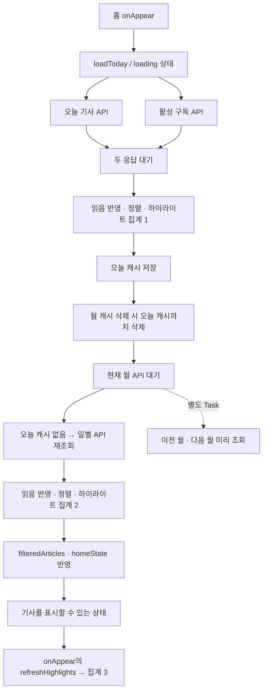

# 홈 첫 표시 분석

**후속 구현·검증 — 2026-11-13**

사용자의 최적화 요청에 따라 HomeView, HomeViewModel, HomeTests를 수정했다. 아래의 상세 분석과 행 번호는 수정 전 `5d975916` 기준이며, 현재 동작은 다음과 같다.

| 항목 | 수정 전 | 수정 후·검증 결과 |
|---|---|---|
| 첫 기사 표시 조건 | 오늘·구독 결과 이후 월·일별 조회까지 대기 | 오늘·구독 결과와 한 번의 가공 후 기사·계측 상태 확정. 월 응답을 보류한 테스트에서도 ready 확인 |
| 오늘 날짜 일별 API | 1회 추가 호출 | 0회. 일별 mock을 실패하도록 설정해도 오늘 기사 유지 |
| 최초 진입 기사 가공 | `loadToday` 2회 + 직후 갱신 1회 | `loadForAppearance` 전체에서 1회. 상세 복귀 때의 하이라이트 갱신은 유지 |
| 달력 | 기사 표시와 오류 상태에 결합 | 별도 로딩·실패·재시도 표시. 실패해도 기사 ready·목록 ID 유지 |
| 동시 월 요청 | 진입·달력·prefetch 경로에서 별도 요청 가능 | 월별 진행 중 Task 공유. 화면 이탈·인증 초기화·새 조회 시 취소 |
| 오래된 응답 | 일부 UI 검사 전에 상태 변경 또는 캐시 저장 | 세션·선택 요청·월 요청 식별자를 UI와 캐시 반영 전에 확인 |
| 화면 작업 수명 | `onAppear`와 인증 변경에서 별도 Task | `.task(id:)`와 이탈 시 취소. 기사 표시 뒤 중단된 달력 조회는 복귀 시 재개 |

홈 모듈 테스트 **32개 통과**. 기존 20개에 회귀 테스트 12개를 추가했다. 재점검 중 같은 날짜 재선택 후 이전 응답이 캐시를 덮어쓰는 문제를 테스트 실패로 재현했고, 저장 직전 선택 식별자를 확인하도록 수정한 뒤 같은 테스트를 포함해 전체 통과를 확인했다. 실제 네트워크나 sleep 없이 actor·continuation으로 응답 순서를 제어한다.

- 최종 테스트: `scripts/test.sh Home`
- 테스트 로그: `/private/tmp/newdok-home-optimization-final-tests.log`
- 최종 Release 검증: `fastlane build` 성공, 종료 코드 0. 로그: `/private/tmp/newdok-home-optimization-final-release.log`
- 캐시 문제 재현 로그: `/private/tmp/newdok-home-stale-cache-regression.log`
- 실제 단축 시간·메모리·스크롤 hitch는 아직 실기기로 측정하지 않았다. 요청 수와 ready 시점의 의존성 감소를 검증한 결과다.

**변경 이력으로 확인한 설계 원인 — 2026-11-14**

핵심은 월별 기사 목록 중심의 조회 흐름이 월 요약·일별 기사 API 분리 후에도 남았다는 점이다. 아래는 실제 커밋의 부모 버전과 diff를 비교한 결과다. 작성 당시의 일정이나 판단 과정은 이력만으로 단정하지 않는다.

| 시점·근거 | 확인한 변화 | 첫 표시 비효율과의 관계 |
|---|---|---|
| 2025-10-26 [`a3ac4bde`](https://github.com/newdok-dev/Newdok/commit/a3ac4bde) | 월별 `Articles`에 `receivedArticleList`가 있었고, `filterArticles`가 월 데이터에서 선택일 목록을 꺼냈다. `loadToday`는 월 조회 후 완성된 `HomeSnapshot`을 반환했다. | 월 데이터가 기사 표시의 원본이던 구조를 확인할 수 있다. 오늘 응답도 있었지만 표시 경로가 월 데이터에 결합되어 있었다. |
| 2025-12-09 [`87dad611`](https://github.com/newdok-dev/Newdok/commit/87dad611) | 월 DTO를 `hasArticles/totalCount/unreadCount` 요약으로 바꾸고 `/day` API와 `dayArticlesCache`를 도입했다. `storeArticles(today)` 뒤의 `clearMonthlyCache(today)`에 일별 캐시 삭제도 추가했다. | 월 대기 순서는 유지되고, 방금 저장한 오늘 캐시가 삭제되어 일별 API를 다시 호출하는 문제가 생겼다. 캐시 저장과 무효화의 순서가 새 캐시 구조와 맞지 않게 된 직접 근거다. |
| 2026-05-18 [`085f5d6c`](https://github.com/newdok-dev/Newdok/commit/085f5d6c) | 셀별 `@Query`를 제거하고 조회 결과에 하이라이트 수를 주입했다. `onAppear`에는 `loadToday` 뒤 무조건 `refreshHighlights`를 추가했다. | 셀별 조회를 줄인 개선과 함께 최초 진입의 중복 집계가 생겼다. 상세 복귀의 변경 반영과 최초 로드를 구분하지 않은 구조다. |
| 2026-05-19 [`31a7bdca`](https://github.com/newdok-dev/Newdok/commit/31a7bdca) | 큰 actor UseCase를 개별 UseCase로 분리하고 캐시·상태 조합을 ViewModel로 옮겼다. | 코드 책임 위치는 바뀌었으나 저장→삭제→월 대기→일별 조회 순서는 그대로 옮겨졌다. 이 커밋이 캐시 오류의 최초 원인은 아니다. |
| 2026-06-16 [`ee01c1f6`](https://github.com/newdok-dev/Newdok/commit/ee01c1f6) | 읽음 처리의 DB 재조회 제거, 월 캐시 상한, prefetch 중복 방지 등을 적용했다. `clearMonthlyCache` 본문은 `evictMonth`로 추출했다. | 실제 성능 개선은 있었지만 첫 표시의 실행 순서는 유지됐다. `evictMonth` 추출이 오늘 캐시 삭제 문제를 새로 만든 것은 아니다. |

문제가 오래 남은 데에는 검증 범위도 영향을 줬다. `31a7bdca`의 최초 ViewModel 테스트는 오늘·일별 mock에 같은 기사 배열을 넣고 `await loadToday()` 이후 기사 수와 today·구독 호출 수를 검사했다. 불필요한 일별 요청과 월 응답 대기는 이 조건에서도 통과한다. 수정 전 `5d975916`에도 이 핵심 검증의 빈틈이 남아 있었다.

이력에서 도출하는 설계상의 원인은 다음과 같다.

- **데이터 계약 변경 후 실행 순서 미갱신:** 월 데이터의 역할은 기사 원본에서 달력 요약으로 바뀌었으나, 기사 준비의 선행 조건으로 남았다.
- **캐시 무효화 범위와 호출 순서 불일치:** 월 캐시 삭제가 일별 캐시까지 포함하도록 넓어졌는데 새 데이터 저장 위치를 함께 조정하지 않았다. 이후 캐시 미스의 자동 재조회가 정상처럼 보이는 최종 결과를 만들어 오류를 숨겼다.
- **첫 진입과 복귀 갱신의 책임 중복:** View의 appearance 갱신과 ViewModel의 최초 데이터 가공이 같은 하이라이트 정보를 연속 조회했다.
- **리팩터링·국소 최적화와 첫 표시 검증의 분리:** 모듈 분리, actor 변경, lazy 목록, 캐시 상한만으로는 실제 요청 순서가 달라지지 않았다. 최종 결과뿐 아니라 중간 준비 상태·호출 횟수·응답 역전도 확인해야 했다.

이번 수정은 이 실행 순서와 상태 반영 경계를 바꾸고 해당 회귀 조건을 테스트로 고정했다. 위 설명은 코드 이력에 대한 분석이며, 실제 단축 시간은 별도 실기기 측정 대상이다.

**수정 전 분석**

기준: `feat/product-analytics` / `5d975916`, 2026-11-13. 로그인 상태·빈 메모리 캐시·기사 있음·요청 성공·추가 사용자 조작 없음의 경로를 분석했다. CodeGraph, 실제 DI/Repository/API, View/ViewModel 및 기존 테스트 원문을 대조한 결과다.

**결론**

홈 기사 표시를 늦추는 확실한 구조는 오늘 캐시의 즉시 삭제와 월·일별 조회를 기다리는 상태 전환이다. 최초 두 API는 이미 병렬이며, 첫 화면의 기사 목록도 이미 `LazyVStack`이다. 첫 표시 경로의 요청과 데이터 처리 중복을 먼저 줄이는 것이 타당하다.

**현재 실행 순서**

`homeState`가 `.idle` 또는 `.loading`이면 헤더 아래에는 `ProgressView`만 표시된다. `filteredArticles`에 값이 있어도 `.articles` 상태가 되어야 카드가 구성된다. 근거: [HomeView.swift](../Modules/Features/Home/Sources/Home/HomeView.swift) 46–71, 174–208행.

| 단계 | 실제 동작 | 첫 기사 표시와의 관계 | 근거 |
|---|---|---|---|
| 진입 | `shouldReloadToday()`가 처음에는 true이므로 `loadToday()` 실행 | 초기 로딩 시작 | HomeView 101–110행; HomeViewModel 354–358행 |
| 오늘·구독 조회 | `async let` 두 개로 요청 후 두 결과를 모두 기다림 | 필요한 최초 데이터; 이미 병렬 | HomeViewModel 195–198행 |
| 데이터 가공 1 | 로컬 읽음 상태 반영, 미독/ID 정렬, 하이라이트 수 집계 | 이 결과는 아직 화면 배열에 반영되지 않음 | HomeViewModel 202행 |
| 캐시 저장·삭제 | `storeArticles(today)` 바로 뒤 `clearMonthlyCache(today)` | 방금 받은 결과의 캐시가 제거됨 | HomeViewModel 207–208행 |
| 월 조회 | 현재 월 API를 강제로 재조회 | 완료까지 전체 홈이 loading 상태 | HomeViewModel 215행 |
| 일별 재조회 | 캐시가 없으므로 오늘 날짜로 `/articles/day` 호출 | 추가 직렬 대기 | HomeViewModel 216, 463–478행 |
| 데이터 가공 2 | 일별 응답에 읽음·정렬·하이라이트 집계를 다시 적용 | 첫 표시 상태 전환 전에 다시 수행 | HomeViewModel 475행 |
| 표시 상태 반영 | 기사 배열, 달력 요약, 목록 계측 ID 등을 갱신하고 `.articles`로 전환 | 여기서 카드 표시가 가능해짐 | HomeViewModel 217–224, 452–460행 |
| 직후 갱신 | `loadToday` 반환 후 무조건 `refreshHighlights()` | 세 번째 가공·배열 대입·애니메이션 요청 | HomeView 110행; HomeViewModel 361–367행 |

위 행 번호의 ViewModel 원문: [HomeViewModel.swift](../Modules/Features/Home/Sources/Home/HomeViewModel.swift).

상태 변경 시점과 실제 디스플레이에 프레임이 나온 시점은 구분해야 한다. 마지막 하이라이트 갱신이 다음 프레임과 어떻게 겹치는지는 실측 대상이다.

**캐시 문제가 발생하는 정확한 이유**

`storeArticles`는 `dayArticlesCache[dayKey]`에 저장한다(492–494행). `clearMonthlyCache`는 이름과 달리 `evictMonth`를 호출하고(545–549행), `evictMonth`는 월별 요약뿐 아니라 해당 월 prefix의 모든 일별 캐시도 지운다(518–523행). 두 호출 사이에는 await가 없으므로, 현재 순서에서는 새 오늘 캐시도 즉시 제거된다.

월 API는 날짜별 요약을 `monthlyCache`에 저장할 뿐 오늘 기사 배열의 캐시를 복구하지 않는다. 따라서 이후 `loadArticles(today)`는 다시 일별 API를 호출한다. 새 오늘 응답 대신 뒤늦은 일별 응답이 실제 표시 데이터가 된다.

오늘 API 성공 후 일별 재조회가 실패하면 `loadArticles`가 빈 배열을 반환한다. 첫 진입에서 구독 목록이 있으면 `.noArticles`, 구독도 없으면 `.noSubscriptions`로 판정할 수 있고 오류도 설정된다. 정상적으로 받은 오늘 기사를 활용하지 못하는 정확성 문제도 함께 있다.

**요청 수와 처리 횟수**

| 작업 | 현재 정상 첫 진입 | 개선 목표 |
|---|---|---|
| 오늘 API `/articles/today` | 1회 | 1회 |
| 활성 구독 API `/newsletters/subscription/active` | 1회, 오늘 API와 병렬 | 1회, 병렬 유지 |
| 현재 월 API `/articles?year=…&publicationMonth=…` | 1회, 첫 표시 전에 대기 | 달력 갱신으로 수행, 기사 표시를 막지 않음 |
| 오늘 날짜 `/articles/day?...` | 1회, 월 조회 뒤 대기 | 0회 |
| 인접 월 API | 월 조회 성공 후 이전·다음 월 2개 Task 생성 | 첫 기사 준비 이후로 순서 조정; 필요 시 달력 진입 시점과 비교 |
| 기사 가공·하이라이트 집계 | 첫 표시 상태 전환 전 2회 + 직후 1회 | 처음 1회; 상세 화면에서 복귀하면 필요한 갱신 유지 |

API 경로·DTO는 [HomeArticleAPI.swift](../Modules/Features/Home/Data/Sources/API/HomeArticleAPI.swift), [HomeNewsletterAPI.swift](../Modules/Features/Home/Data/Sources/API/HomeNewsletterAPI.swift)에서 확인했다. 표의 호출 횟수는 이 코드 경로의 논리적 호출 기준이며, 인증 재시도·이미지 다운로드·다른 탭 요청은 제외한다. 인접 월 두 요청은 직접 await하지 않으므로 첫 표시가 반드시 그 완료까지 기다리는 것은 아니다.

단순화한 첫 표시 준비 시간은 현재 `max(오늘, 구독) + 가공1 + 월 + 일별 + 가공2 + 상태 반영`이다. 목표는 `max(오늘, 구독) + 가공1 + 상태 반영`이다. 이는 실행 의존성을 표현한 식이며 실제 시간 측정치가 아니다.

**하이라이트 집계의 실제 비용**

[DecorateArticlesUseCaseImpl.swift](../Modules/Features/Home/Sources/UseCase/DecorateArticlesUseCaseImpl.swift) 10–44행은 읽음 상태 map, 정렬, 하이라이트 집계를 수행한다. [HighlightCountRepositoryImpl.swift](../Modules/Features/Home/Data/Sources/Repository/HighlightCountRepositoryImpl.swift) 11–12행은 로컬 저장소를 호출한다.

[DefaultHighlightLocalDataSource.swift](../Modules/DatabaseKit/Sources/DefaultHighlightLocalDataSource.swift)는 MainActor에 격리되어 있고, 107–119행에서 관련 SwiftData 엔티티를 일괄 fetch한 뒤 개수를 센다. 기사마다 개별 쿼리를 보내는 구조는 아니다. 다만 중복 가공마다 같은 범위의 DB fetch가 반복된다. 기사 배열이 비어 있으면 DB 집계는 생략한다. 저장소의 actor 경계를 바꾸기 전에 이 중복 호출부터 제거할 수 있다.

**첫 표시와 분리해 봐야 하는 항목**

| 항목 | 현재 구현 | 판단 |
|---|---|---|
| 로딩 GIF | 첫 진입은 `ProgressView`; GIF는 pull-to-refresh의 animationView | GIF 개선을 홈 첫 진입 개선 효과로 계산하지 않음 |
| 목록 생성 | HomeView 245행의 `LazyVStack` | 홈 전체를 lazy로 바꾸는 작업보다 요청 순서가 우선 |
| 썸네일 | [ArticleRow.swift](../Modules/Features/Home/Sources/Home/ArticleRow.swift) 25–35행의 Kingfisher·다운샘플링·56pt 프레임 | 이미지 완료가 `homeState` 전환 조건은 아님. 텍스트 카드 표시와 썸네일 완성 시간을 별도 측정 |
| 헤더 표시 | HomeView 49행은 loading 분기 밖 | 홈 화면 자체의 첫 프레임과 기사 준비 시간을 구분 |
| 재방문 | 동일 사용자·동일 날짜이고 `isLoaded`이면 today 재조회 생략 | 첫 진입과 상세 복귀의 비용을 섞지 않음 |
| 게스트 | `loadToday` 전에 guest 상태로 표시 | 로그인 사용자의 4개 요청 경로와 구분 |

**수정 순서와 반드시 보존할 동작**

| 순서 | 변경 | 필요한 확인 |
|---|---|---|
| 1 | 월 캐시 무효화를 오늘 기사 저장 앞으로 옮긴다. | 새로고침에서 기존 월 데이터는 무효화되면서 새 오늘 응답은 남아야 한다. 오늘 API와 날짜 지정 API의 날짜 기준·필드 의미는 fixture/서버 계약으로 확인한다. 두 API는 같은 Domain 모델로 변환되지만 원래 JSON 형식은 다르다. |
| 2 | 오늘 기사·구독·표시 날짜·목록 ID를 확정한 뒤 월 데이터를 기다린다. | `.articles`만 앞당기면 부족하다. `isTodayLoading`이 true인 동안 `analyticsState`는 nil이며 일부 액션 계측도 건너뛴다. 표시 데이터와 계측 준비 상태를 함께 전환한다. |
| 3 | 달력 갱신은 기사 표시와 분리하고 늦은 응답을 검증한다. | 사용자가 먼저 다른 날짜·월로 이동했거나 계정이 바뀌면 이전 월 응답이 화면을 되돌리지 않아야 한다. 월 완료 시 오늘 요약을 새 기사와 합치는 동작도 유지한다. |
| 4 | 최초 로드 뒤 무조건 수행하는 하이라이트 갱신을 생략한다. | 상세에서 하이라이트를 추가·삭제한 뒤 복귀할 때 갱신은 유지한다. |
| 5 | 진입 작업 수명을 `.task(id:)`로 정리한다. | 취소된 이전 응답을 무시하고, 달력 갱신 도중 이탈했다 돌아와도 미완료 작업을 올바르게 재개해야 한다. |

달력 실패는 이미 성공한 기사 조회와 구분해야 한다. 현재 월·인접 월 실패도 공용 `currentError`를 설정하며, `analyticsState`는 serverError이면 목록 전체를 failed로 판단한다. 기사 표시를 앞당기는 수정에는 이 실패 범위와 목록 이벤트 의미도 포함된다.

달력 팝업은 `isLoading` 입력을 갖지만 현재 홈 호출부에서는 연결하지 않고, 팝업 body도 그 값을 사용하지 않는다. 기사 표시 후 사용자가 달력을 먼저 열 수 있게 되므로 준비 중인 날짜 표시의 UX도 함께 확인해야 한다. 근거: [CalendarPopupView.swift](../Modules/DesignSystem/Sources/Component/CalendarPopupView.swift) 45, 68–79행; HomeView 75–83행.

`.task(id:)`는 View 수명과 입력 변경에 맞춰 취소·재시작할 수 있다. 취소가 실제로 처리되도록 await 이후 검증은 계속 필요하다. [Apple task 문서](https://developer.apple.com/documentation/swiftui/view/task%28id%3Aname%3Apriority%3Afile%3Aline%3A_%3A%29)

**기존 테스트의 빈틈과 회귀 검증**

[HomeTests.swift](../Modules/Features/Home/Tests/HomeTests.swift) 61–82행은 오늘·일별 mock에 동일한 기사 배열을 넣고 최종 기사 수, today 호출 수, 구독 호출 수만 검사한다. 일별 API를 불필요하게 호출해도 테스트가 통과하는 조건이다. 월 요청이 끝나기 전 기사 상태가 준비되는지도 검사하지 않는다.

추가할 핵심 검증은 다음과 같다. 임의 sleep 대신 continuation으로 응답 순서를 제어한다.

| 시나리오 | 기대 결과 |
|---|---|
| 오늘 응답 A, 일별 mock 응답 B | 홈에는 A가 남고 일별 호출 수는 0 |
| 월 응답을 보류 | 오늘·구독·가공 완료 후 기사 표시 상태 및 올바른 계측 ID가 준비됨 |
| 월 조회 실패 | 오늘 기사 유지, 달력 실패 처리와 기사 ready 상태의 의미 보존 |
| 오늘·구독 응답 둘 중 하나 실패 | 기존 오류·빈 상태 정책에 맞고 잘못된 ready 이벤트가 발생하지 않음 |
| 기사 없음 | 구독 유무로 `.noArticles`와 `.noSubscriptions`를 구분 |
| 최초 진입 vs 상세 복귀 | 최초 가공 1회, 복귀 시 하이라이트 변경 반영 |
| 월 대기 중 날짜·계정 변경 | 이전 응답이 현재 날짜·기사·계측 ID를 덮어쓰지 않음 |
| 기사 표시 후 달력 완료 전 이탈·복귀 | 카드와 캐시가 일치하고 필요한 달력 갱신이 누락되지 않음 |

구현 후 최소 `./Modules/Features/Home/test.sh`를 실행한다. 공통 달력·DatabaseKit까지 수정한다면 저장소 규칙에 따라 전체 테스트를 실행한다. 실측은 헤더 첫 프레임, 텍스트 기사 준비, 첫 화면 썸네일 준비, 달력 준비, 후속 요청 수를 각각 기록한다.
